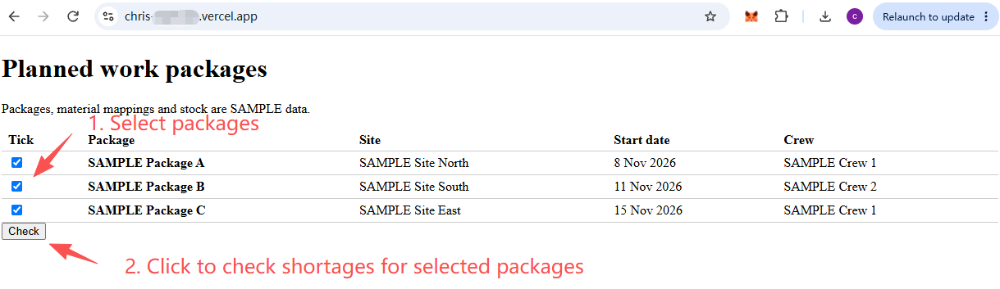
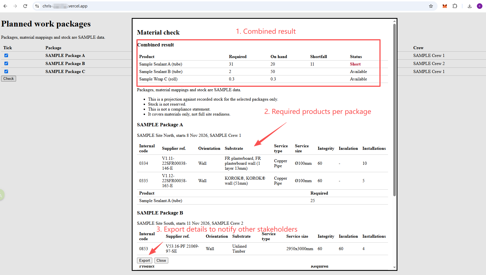
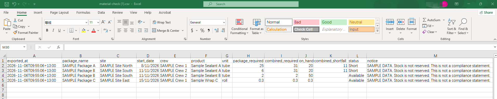
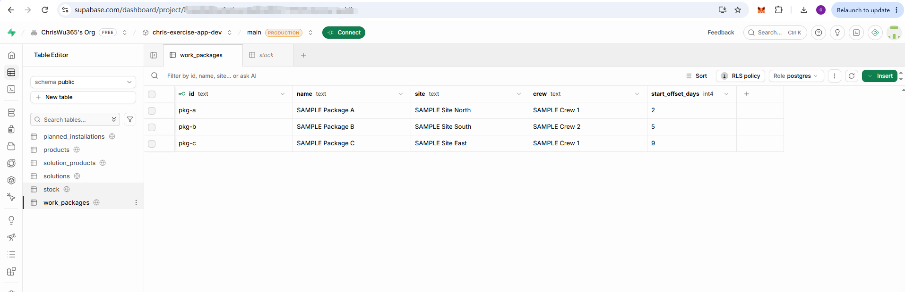

# Material readiness check

Before going on site, a construction team leader ticks the work packages they plan to do and checks whether recorded stock covers them together. They see which materials fall short, and can export the result as a CSV to share with people outside the system.

Packages, material mappings and stock are all SAMPLE data.

| | |
| --- | --- |
| **Live app** | <https://chris-exercise.vercel.app/> (no sign-in) |
| **Code** | <https://github.com/ChrisWu365/chris-exercise> |
| **CI/CD runs** | [All runs](https://github.com/ChrisWu365/chris-exercise/actions), and [a successful deployment](https://github.com/ChrisWu365/chris-exercise/actions/runs/42102553835) |

## Table of contents

- [How to review this](#how-to-review-this)
- [Demonstration](#demonstration)
- [Sample data](#sample-data)
- [File structure](#file-structure)
- [Run locally](#run-locally)
- [Run the tests](#run-the-tests)
- [Deploy](#deploy)
- [Known limitations](#known-limitations)

## How to review this

Follow the [review guide](docs/00-how-to-review.md). My [agentic coding approach](docs/05-agentic-coding-approach.md) explains how the coding agents were guided and corrected. The [submission list](docs/06-submission.md) links each item the brief asks for.

## Demonstration

This takes about two minutes, on a desktop or phone. The numbers come from the SAMPLE data, and automated browser tests check them against the live site.

| Step | Do this | You should see |
| --- | --- | --- |
| 1 | Open the [live app](https://chris-exercise.vercel.app/) | Three packages, soonest first. There are no statuses yet, and "Check" is disabled |
| 2 | Tick `SAMPLE Package A`, then click "Check" | Sample Sealant A: required 25, on hand 20, shortfall 5, `Short` |
| 3 | Read on through the dialog | Notices saying this is a projection, stock is not reserved, it isn't a compliance statement, and it covers materials only. Then the package's planned installations |
| 4 | Click "Close", tick `SAMPLE Package B` as well, then click "Check" | The packages are combined. Sample Sealant A: required 31, shortfall 11, `Short`. Sample Sealant B: required 2, on hand 50, `Available`, with no shortfall |
| 5 | Find `9998` under Package B | Its catalogue details are blank because the code isn't in the catalogue, but its materials still count |
| 6 | Find `0853` under Package B | Its substrate is cleaned to `Unlined Timber`, and its service type is blank |
| 7 | Click "Export", then open the file | One row per product per package, with the package's and the combined figures, the export time in Auckland and the notice |
| 8 | Close the dialog, untick both packages, tick `SAMPLE Package C`, then click "Check" | Sample Wrap C: required 0.3, on hand 0.3, `Available`. This shows exact decimal arithmetic |

These screenshots show all three packages ticked together, so their figures combine steps 4 and 8.

**Select packages, then click "Check":**



**See the combined result, the required products per package, and "Export":**



**Open the exported file, to share with other stakeholders:**



The file stores `start_date` as `2026-11-08`. Excel shows it in your computer's date format.

## Sample data

| Data | Source |
| --- | --- |
| Solutions catalogue, 148 rows | Supplied: [`data/source/solutions-excerpt.csv`](data/source/solutions-excerpt.csv), cleaned when seeded |
| Products, material mappings, packages, planned installations and stock | **Invented for this exercise:** [`data/sample/sample-data.json`](data/sample/sample-data.json) |

The supplied file has no product column, so which products a solution uses, and in what quantity, is invented. Nothing here is a real specification or a real stock level. Code `9998` is deliberately missing from the catalogue, to show that case. [Design section 9](docs/03-technical-design.md#9-sample-data-and-the-production-inventory-source) has more detail.

**The seeded data in Supabase, showing the six tables and the SAMPLE work packages:**



## File structure

```text
├── AGENTS.md, CLAUDE.md     Instructions for the coding agents
├── .github/workflows/       CI/CD pipeline
├── data/
│   ├── source/              Supplied solutions catalogue
│   └── sample/              Invented SAMPLE data
├── docs/
│   ├── 00-how-to-review.md
│   ├── 01-iteration-plan.md
│   ├── 02-slice-spec.md
│   ├── 03-technical-design.md
│   ├── 04-test-strategy.md
│   ├── 05-agentic-coding-approach.md
│   ├── 06-submission.md
│   ├── adr/                 Architecture decision records
│   └── agent-log.md         Prompts, files read, corrections and rejections
├── src/
│   ├── app/                 Dashboard page and the "Check" server action
│   ├── components/          Package list, results dialog and notices
│   ├── data/                Supabase queries, server only
│   └── domain/              Check rules, exact quantities, CSV builder and dates
├── scripts/                 Seed script and pipeline checks
├── supabase/migrations/     Database schema and security rules
├── tests/
│   ├── integration/         Data access, check logic and security rules
│   └── seed/                Seed script against a real database
└── e2e/                     Browser tests
```

Unit and component tests sit beside the code they test, in `src/` and `scripts/`.

## Run locally

You need Node.js 24 and your own Supabase project.

1. Install the dependencies, and link your project:

   ```sh
   npm ci
   npx supabase login
   npx supabase link --project-ref <your-project-ref>
   npx supabase db push
   ```

2. Copy `.env.example` to `.env.local`. Add your project's URL and its publishable key as `SUPABASE_ANON_KEY`.

3. Create `.env.seed.local.local` for the seed script, then load the data. In Supabase, the key is under **Project Settings → API Keys → Secret keys**. The seed script is the only code that uses it, and these files are git-ignored.

   ```
   SUPABASE_URL=<your project's URL>
   SUPABASE_SERVICE_ROLE_KEY=<your project's secret key>
   ```

   ```sh
   npm run seed -- --target local
   ```

4. Start the app, and open <http://localhost:3000>:

   ```sh
   npm run dev
   ```

## Run the tests

Every push runs all of these in CI, which builds a throwaway database from the migrations.

| Tests | Command | Needs |
| --- | --- | --- |
| Lint, types and "every criterion has a test" | `npm run lint && npm run typecheck && npm run check:ac-coverage` | Nothing |
| Unit and component | `npm test` | Nothing |
| Browser, on desktop and phone sizes | `npm run build && npx playwright install chromium && npm run test:e2e` | A seeded project in `.env.local` |
| Database access, read-only checks and security rules | `node --env-file=.env.local node_modules/vitest/vitest.mjs run --dir tests/integration` | A seeded project in `.env.local` |
| Seed script | `npm run test:seed` | CI's throwaway database only |

**Don't run `test:seed` against a project you want to keep:** it deletes and rewrites data.

To run the browser tests against the live site, which only read data, set `SMOKE_URL` first: `SMOKE_URL=https://chris-exercise.vercel.app/ npm run test:e2e`.

## Deploy

GitHub Actions deploys on every push to `main`, after all checks pass. It applies new database migrations, then deploys to Vercel. Other branches run the checks only.

**A successful run on `main`, where the checks pass and then the deployment runs:**


To set up your own copy:

1. Create a separate Supabase project for production, then link it and apply the migrations as above.
2. Create `.env.seed.production.local` with its URL and secret key, then run `npm run seed -- --target production`.
3. Create a Vercel project, without connecting it to Git. Add `SUPABASE_URL` and `SUPABASE_ANON_KEY` for production, using the production project's URL and publishable key.
4. In the GitHub repository's Actions settings, add:

   | Type | Name | Value |
   | --- | --- | --- |
   | Secret | `SUPABASE_ACCESS_TOKEN` | Supabase personal access token |
   | Secret | `SUPABASE_DB_PASSWORD` | Production database password |
   | Secret | `VERCEL_TOKEN` | Vercel access token |
   | Variable | `SUPABASE_PROJECT_REF` | Production project reference |
   | Variable | `VERCEL_ORG_ID` | Vercel team ID, starting `team_` |
   | Variable | `VERCEL_PROJECT_ID` | Vercel project ID |
   | Variable | `PRODUCTION_URL` | The site's public URL |

5. Push to `main`.

Seeding is a manual step. If a deployment adds new tables, seed again straight after it. The secret key is never stored in GitHub or Vercel.

## Known limitations

**This exercise compared with production:**

| Area | In this exercise | For production |
| --- | --- | --- |
| Data | Invented products, quantities, packages and stock | Real project, mapping and inventory sources |
| Access | Public and read-only, with no sign-in | Sign-in, and each team leader sees only their own work |
| Stock | Recorded figures with no timestamp, and nothing is reserved | A stock source with a timestamp. Reservation is planned for iteration 3 |
| Packages | The result combines only the ticked packages, and doesn't show which one would go without | Consider all committed work |
| Escalation | The team leader shares the CSV by hand, and no record of the export is kept | Notifications and tracking, planned for iteration 2 |
| Alternatives | Not offered. A catalogue match doesn't prove a substitute is compliant | A review and approval process, planned for iteration 4 |
| Connection | Needs a connection to run a check. Only a result already shown can be exported offline | Offline use, if team leaders need it on site |
| Scale | All packages load at once, which suits this small sample | Paging, and handling Supabase's limit of 1,000 rows per response |
| Placement | A standalone app, because the existing code isn't available | A feature in the existing web app, as the [design](docs/03-technical-design.md) recommends |

**Pipeline gaps:**

- **Limited check after deploying:** CI only confirms that the public URL responds. The fuller smoke test is switched off.
- **No rollback:** a failed deployment needs fixing by hand.
- **Rebuilt for deployment:** the deployed build is made separately from the one that was tested.
- **No required checks or approval:** failing checks don't block a merge to `main`, and there is no GitHub Environment to approve deployments.
- **No automatic dependency updates:** there is no Dependabot, and `npm audit` reports 8 moderate warnings in development tools.
- **No browser test of a database outage:** component and integration tests cover those failures.
