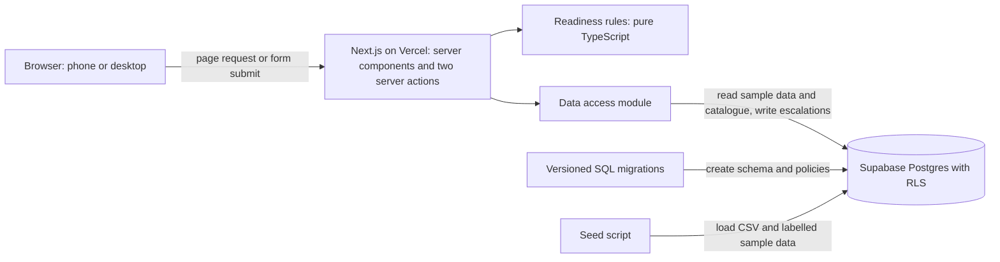
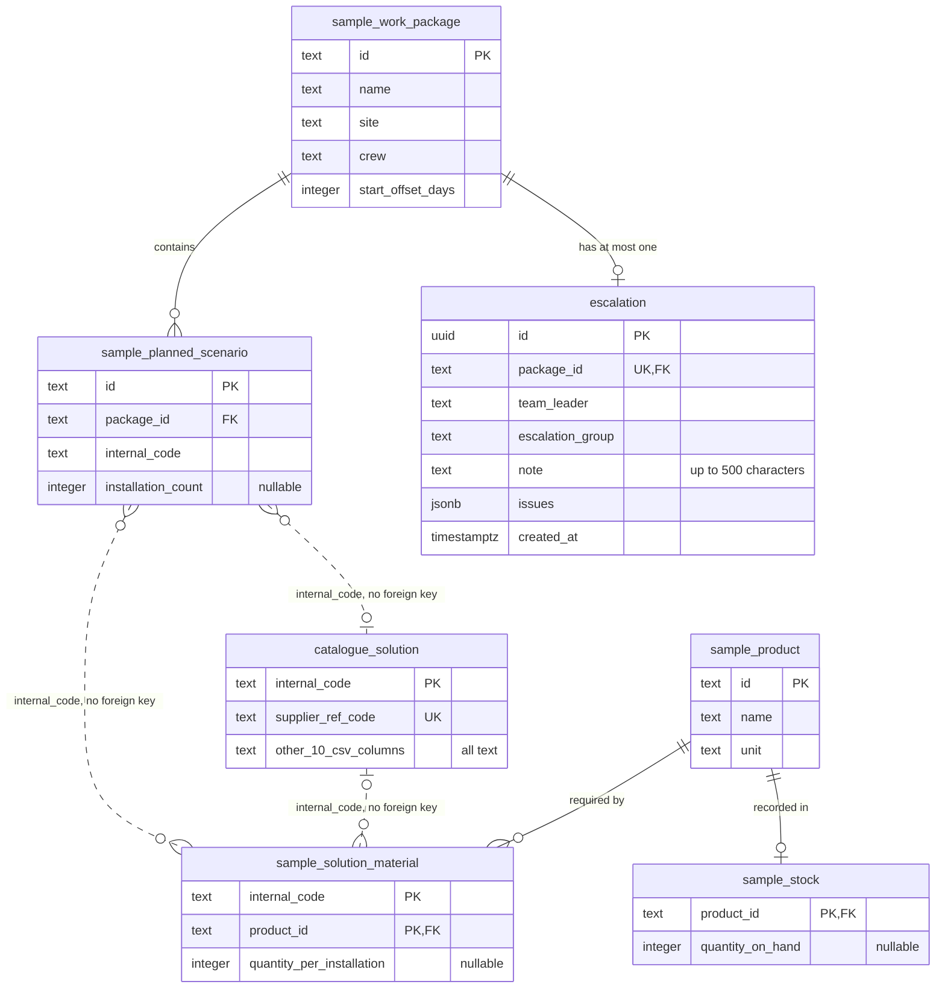

# Technical design: material readiness dashboard

This design implements [the first-slice specification](02-slice-spec.md). FR and AC numbers refer to that document.

## Table of contents

1. [Overview](#1-overview)
2. [Terms](#2-terms)
3. [Projected coverage is not reservation](#3-projected-coverage-is-not-reservation)
4. [User flow](#4-user-flow)
5. [Components and interfaces](#5-components-and-interfaces)
6. [Data model](#6-data-model)
7. [Database as Code](#7-database-as-code)
8. [Where the business rules live](#8-where-the-business-rules-live)
9. [Sample data and the production inventory source](#9-sample-data-and-the-production-inventory-source)
10. [Fit with the stack and repository](#10-fit-with-the-stack-and-repository)
11. [Security](#11-security)
12. [Failure handling](#12-failure-handling)
13. [Deployment and CI/CD](#13-deployment-and-cicd)
14. [Main trade-offs](#14-main-trade-offs)
15. [Decisions](#15-decisions)

## 1. Overview

The slice is a server-rendered Next.js web app backed by Supabase Postgres and deployed on Vercel. The browser talks only to the Next.js server. The server reads one page of packages, calculates readiness in a pure TypeScript module, and renders the result. The only writes are recording an escalation and deleting escalations through the demo reset.



## 2. Terms

| Term | Meaning |
| --- | --- |
| Solution | One row of the supplied catalogue, identified by `Internal Code`. |
| Work package | A planned piece of site work for a crew. |
| Planned scenario | A use of one solution in a package, with the number of installations planned. |
| Product | A material used to install a solution. Products are sample data, because the catalogue has none. |
| Product line | One product in one package, with its total required quantity compared to stock. |
| On hand | The stock quantity currently recorded for a product. It may differ from what is physically there. |
| Current date | Today's date in Auckland (`Pacific/Auckland`), whatever time zone the server runs in. |
| Issue | Something a team leader can escalate: a `Short` or `Unknown` product line, or a solution with no mapped materials. |
| Valid count or quantity | A whole number of 1 or more. Blank, 0, negative, decimal or non-numeric values are not valid. |
| Valid stock figure | A whole number of 0 or more. No record, blank, negative, decimal or non-numeric values are not valid. Zero is real stock, so it gives `Short`. |
| `Unknown` | "We can't tell yet, because some information is missing. This doesn't mean the material is out of stock. Don't rely on it until it's confirmed." |

## 3. Projected coverage is not reservation

The specification calculates **projected coverage**: a read-only comparison of a package's required quantities with the current recorded stock. It answers "would recorded stock cover this package if nothing else used it?"

| | Projected coverage (this slice) | Stock reservation (iteration 3 at the earliest) |
| --- | --- | --- |
| What it is | A calculation made each time a page is viewed | A stored commitment of stock to a package |
| Effect on inventory | None; the app never writes to stock tables | Would reduce the stock free for other packages |
| Effect on other packages | None; two packages can both be covered by the same stock | Would prevent the same stock being committed twice |
| What a team leader can rely on | "The recorded figures appear sufficient for this package" | "This stock is held for this package" |

The design enforces this in three ways:
- **Database:** the app's database role can only read stock, so a defect in the app can't change it (section 11).
- **Rules:** the readiness module is pure, so a calculation can't write anything.
- **Wording:** FR-5 tells the user stock isn't reserved. The UI avoids words such as "allocated", "held" and "reserved" for any calculated figure.

**Package priority:** the current design has no priority between packages. Each package is checked separately against all recorded stock, and "soonest first" is display order only. Accounting for other packages would be a future spec change (section 15).

**Stock freshness:** no threshold is used. Stock is shown as recorded, and the sample data has no source timestamp to display.

## 4. User flow

1. **Open the list (`/?page=1`).** The team leader sees 10 packages, soonest first, with the total package count. Each row shows the name, site, start date, crew, status, issue count and any escalated state. The status column is headed "Material readiness", so `Looks ready` can't be read as full site readiness. An `Unknown` status always says what needs attention, such as "Unknown: 2 items need checking".
2. **Read the notices.** These are always visible: sample data, the `Looks ready` caveat, the public-demo statement, and the statement that stock was checked only for packages on this page. No totals by status are shown.
3. **Open a package (`/packages/[id]`).** The detail shows scenarios with verbatim catalogue values, then each product line's required quantity, stock, shortfall and status. Each `Unknown` shows its cause and next step (FR-10). "Back to list" returns to the same page (AC-7).
4. **Record an escalation.** If the package has issues, a form offers an optional note, warns that notes are public, and submits.
5. **See the outcome.** The page shows the note, when and to which group the package was escalated, and that nobody has been notified. Status doesn't change (AC-14), and the same state appears after a reload (AC-11).
6. **Reset the demo, if needed.** "Reset demo" on the list asks for confirmation, then deletes all escalations (FR-11).

## 5. Components and interfaces

### Proposed structure

The repository has no application code yet, so this structure is new. Its `.gitignore` already anticipates Next.js, TypeScript and Vercel.

```text
src/app/                 list page, package detail, error and not-found states
src/app/actions/         recordEscalation and resetDemo server actions
src/components/          status label, notices, package table, pagination, escalation form, reset control
src/domain/              readiness rules and validation; no framework or database imports
src/data/                Supabase queries, mapping rows to domain types (server only)
scripts/seed.ts          CSV import and sample data load
data/sample/             labelled sample data files
supabase/config.toml     Supabase CLI project settings
supabase/migrations/     versioned schema and RLS policies
.github/workflows/       CI/CD pipeline
```

### Interfaces

The UI is served by server components and two server actions, so the slice has no public REST API.

| Interface | Input | Output |
| --- | --- | --- |
| `GET /?page=n` | Page number; invalid, missing and out-of-range values are handled by the page | One page of assessed packages with total, or the empty or "page doesn't exist" state |
| `GET /packages/[id]` | Package ID | Scenarios, assessed lines, issues and any escalation, or not found |
| `recordEscalation` server action | Package ID and optional note | `recorded` or `already_recorded` with the escalation; or `invalid_note`, `package_not_found`, `no_issues` or `unavailable` |
| `resetDemo` server action | None | `reset` or `unavailable` |
| `listPackages(page, today)` in `src/data` | Page number and the current date in Auckland | Package rows and total, using `.range()` with `count: exact`, ordered by start date then ID (AC-6) |
| `getAssessmentInputs(packageIds)` in `src/data` | Up to one page of IDs | Scenarios, material mappings, catalogue matches, stock and escalations for those packages only |
| `assessPackage(input)` in `src/domain` | Scenarios, mappings, catalogue matches and stock | Lines, issues, status and issue counts |

The list page number stays in the browser. The list URL holds it, and "Back to list" uses browser history to return there, so the package detail doesn't need it as an input. If a package is opened directly with no history, the link goes to page 1.

Server components call `src/data` directly because this web UI is the only consumer.

## 6. Data model

All catalogue columns are text, so values stay verbatim (AC-8). Tables prefixed `sample_` hold invented data. Solid lines are foreign keys enforced by the database. Dotted lines match on `internal_code` but have no foreign key, so the database doesn't require the code to exist in the catalogue.



### How package demand reaches stock

This example is the AC-1 case, using two real catalogue codes with invented materials:

| Step | Table | Example |
| --- | --- | --- |
| 1. Find the package's scenarios | `sample_planned_scenario` by `package_id` | 10 installations of solution `0334`; 5 of solution `0335` |
| 2. Show each solution's catalogue details | `catalogue_solution` by `internal_code` | Orientation, substrate and so on, as supplied |
| 3. Find the materials each solution needs | `sample_solution_material` by `internal_code` | `0334` needs 2 Sample Sealant A; `0335` needs 1 |
| 4. Total by product | Calculated in `src/domain` | (10 × 2) + (5 × 1) = 25 Sample Sealant A |
| 5. Compare with stock | `sample_stock` by `product_id` | 20 on hand, so `Short` by 5 |
| 6. Save figures if escalated | `escalation.issues` | One entry for Sample Sealant A: required 25, stock 20, shortfall 5 |

### Key design points

- **What is and isn't enforced on `internal_code`:** in `catalogue_solution` it is the primary key, so each code there is unique and present, and the import fails otherwise (AC-9). What's left out is a foreign key from the two sample tables to that primary key. With one, a code missing from the catalogue could never be stored, and the app could never show that `Unknown` cause. Production could add the foreign key if planning records are chosen from the catalogue, while keeping the rule as a safeguard.
- **Several entries with the same missing code:** the sample tables allow this because `internal_code` isn't their whole primary key. `sample_planned_scenario` is keyed by `id`, so any number of scenarios can use code `9999`. `sample_solution_material` is keyed by `internal_code` and `product_id`, so `9999` can list several products, each once. Nothing is added to the catalogue. Section 8 sets out how these are reported.
- **Sample ID types:** `id`, `package_id` and `product_id` are text only so that sample data stays readable, such as `pkg-03`. These types are for the sample tables only. Production should use `bigint` or `uuid` keys, since long text keys can slow joins and indexes at volume. `internal_code` stays text, or becomes a separate text column beside such a key, because it is a business code with leading zeros.
- **Nullable columns:** blank counts, quantities and stock figures must also be storable to reach `Unknown`. A missing `sample_stock` row means "no stock record".
- **One escalation per package:** `UNIQUE (package_id)` enforces this, even for concurrent submissions (AC-12).
- **Atomic save:** the issues are stored as JSONB in the escalation row, so saving is a single insert.
- **Structure of each `issues` entry:** `kind` (`line` or `solution`), `internalCode`, `productId` and `productName` where they apply, `status`, `causes`, `required`, `stock` and `shortfall`.
- **Fixed values:** the fictional team leader and escalation group are server constants copied onto each record. One fictional user doesn't justify extra tables.

## 7. Database as Code

The database structure is defined entirely by versioned files in the repository:

- **Single source:** tables, constraints, indexes and RLS policies change only through timestamped SQL files in `supabase/migrations`, never through the Supabase dashboard.
- **Same path everywhere:** local, CI and production all apply the same files with the Supabase CLI, which records what has been applied in each database.
- **Forward fixes only:** applied files are never edited. A mistake is corrected with a new migration, and each must stay compatible with the app version that is running.
- **CI checks:** CI rebuilds a database from empty using every migration, and fails if it differs from them. Before deploying, it also fails if the hosted schema has drifted from the migration history.
- **Data kept separate:** migrations hold structure only. Catalogue and sample data are loaded by `scripts/seed.ts`, which can rerun safely and never touches `escalation`.
- **Review:** migrations go through pull requests with the code that depends on them. RLS policies are tested alongside them (section 11).

## 8. Where the business rules live

| Rule | Location |
| --- | --- |
| Required quantity, valid values, line status, package status, issues (FR-2, FR-3) | `src/domain`, the single implementation |
| Note and page number validation (AC-13, FR-9) | `src/domain`, called by the server action and page; the database also limits note length |
| One escalation per package (FR-7) | Database constraint; the action turns a duplicate into `already_recorded` |
| Page size, order and tie-break (FR-1, AC-6) | `src/data` |
| User-facing wording for notices, statuses, causes and next steps (FR-5, FR-10) | One module in `src/components`, so required wording is tested in one place |

The rules are applied in this order:
1. A product line is `Unknown` if any of its inputs isn't valid (section 2) or a contributing solution code isn't in the catalogue. All its causes are listed, each with its FR-10 message and next step.
2. Otherwise, the line is `Short` if required is greater than on hand, and `Available` if not.
3. A solution with no mapped materials has no product line to show, so it becomes its own `Unknown` issue. This lets AC-4 hold even when every other line is `Available`. A code used by several scenarios in a package gives one issue and one cause per affected line, not one per scenario; different codes are reported separately.
4. Package status follows FR-3, with those solution issues counted as `Unknown`.
5. A package with no scenarios is `Unknown` with no issues, so it shows the FR-10 message and has no escalation action.

Valid quantities are whole numbers, so no rounding is needed. The database's integer columns already reject decimals and non-numbers from the demo seed data, so unit tests cover those cases directly, as real source data may contain them.

`assessPackage` receives stock as an input, so a future change could alter what it receives without rewriting the line rules. Nothing beyond that parameter is built for this.

## 9. Sample data and the production inventory source

The supplied CSV is a solutions catalogue. It has no products, material quantities, inventory, packages or schedules, and the spec records that the product column the brief mentions is absent. Everything else is sample data:

- **Labelling:** files live in `data/sample/` with a "SAMPLE DATA: invented for this exercise" field, tables have the `sample_` prefix, and the UI notice is always visible (FR-5). Product names are fictional, so no mapping can be mistaken for a real specification.
- **Separation:** only `src/data` knows about the `sample_` tables and the start-date offset. Real sources can replace them without changing `src/domain`.
- **Import:** `scripts/seed.ts` parses the CSV with a real parser, because `Substrate` contains quoted commas. It keeps values verbatim and fails if there aren't 148 rows or if a code is missing or duplicated (AC-9). It validates all the data before writing anything.

| The sample data lets us demonstrate | It leaves untested |
| --- | --- |
| Every status and `Unknown` cause, pagination, the escalation flow and its failure states, and the reset | Whether real stock records are accurate or timely, whether real solutions have per-installation quantities, real volumes, and real escalation routing |

**What production would need from an inventory source.** The brief doesn't identify a stock system, so these are requirements rather than a chosen product:
- **Stock figures:** the quantity on hand for each product, with its unit and location. "No record" must be distinguishable from zero.
- **Matching products:** stock items must use the same product IDs as the list of materials each solution requires. The team that owns specifications must confirm those materials and quantities, or shortage figures will be wrong.
- **Responsibility and access:** a named person or team must be responsible for keeping stock figures correct. The platform needs permission to read them, and one customer must never see another customer's stock.
- **Timing:** a timestamp showing when each figure was last updated, so the screen can display it. A freshness limit should be applied only if the business agrees one.
- **Later iterations:** stock already committed to other work and incoming deliveries, if iterations 2 and 3 are to use them.

## 10. Fit with the stack and repository

| Technology | Use in this slice | Reason |
| --- | --- | --- |
| Next.js, React, Node.js | UI, server rendering and server actions | Current stack; keeps credentials and rules on the server |
| Supabase | Postgres database and migrations | Current stack; constraints and RLS provide the needed guarantees. Auth, realtime and storage aren't needed |
| Vercel | Hosting | Current stack; provides the public URL |
| Flutter | Not used in this slice | The check happens before site work, with a connection (assumption 1). A responsive web page covers phone use without a new app release |

There are no departures from the stack. New dependencies are limited to `@supabase/supabase-js`, TypeScript, ESLint, the Supabase CLI, a CSV parser for the seed script, and test tools set out in the test strategy. There is no UI component library, since CSS Modules are enough for these few screens. Versions are pinned when the app is scaffolded, because the repository has none to follow yet.

### Two ways this could fit the existing platform

The existing web app's code isn't part of this exercise, so both options need validating against it.

| | New service on the same stack | Feature in the existing web app |
| --- | --- | --- |
| **Benefits** | Independent releases; the team already knows the stack | Reuses sign-in, tenants and real records; one place for users |
| **Costs** | Needs shared sign-in, plus access to project and stock data, which either couples it to the existing database or needs an API | Tied to that app's conventions and release cycle |
| **What moves** | `src/domain` and the screens stay; `src/data` reads real sources | `src/domain` and the screens move in; `src/data` is rewritten; migrations join that app's history, without the `sample_` tables or the reset |
| **Use it when** | A separate team or release cycle justifies the extra integration | By default, because this slice is mostly screens over existing data |

- **For the exercise:** this repository takes the new-service shape, because the existing code isn't available and the brief needs a public URL.
- **For production:** the recommendation is the feature in the existing web app, unless a separate team or release cycle justifies a service.

### Offline-first mobile app

Neither option changes the Flutter app now. If team leaders prove to need this check on site, the rules would be exposed through an API. The mobile screen would need to show when its data was last synced, because offline figures can be out of date, and queue escalations until a connection returns. Rules would stay on the server, to avoid two implementations.

## 11. Security

- **Least privilege:** the running app uses only the anon key, held in a server-side environment variable with no `NEXT_PUBLIC_` prefix. Every table has RLS enabled, defined in migrations and covered by tests:

| Tables | Anon role can |
| --- | --- |
| `catalogue_solution` and all `sample_` tables | `SELECT` only |
| `escalation` | `SELECT`, `INSERT` and `DELETE`, with no `UPDATE`. `DELETE` exists only for the demo reset |

- **Service-role key:** used only for seeding, from CI secrets or a local environment, and never by the running app.
- **Browser access:** browser code never contacts Supabase.
- **Input and output:** the server action validates input again regardless of the client, and calculates issues itself rather than accepting them from the client. React escapes output, and `dangerouslySetInnerHTML` is not used (AC-13). Next.js checks the origin of server action requests.
- **Public demo:** with no sign-in, anyone can escalate, read every note or reset at any time, as the UI states (FR-5). This is the demo's convenience and its shortage. One visitor can wipe another's records, and notes can contain unwanted text until reset.
- **Rate limiting:** not needed for this slice, because the table can never hold more than one record per seeded package, each with a note of up to 500 characters.
- **Privacy:** only fictional data is seeded, and the form warns against real details. Logs leave out note content.
- **Production gaps:** real sign-in, roles, tenant-scoped RLS, attributable audit history, and removing the reset and its `DELETE` permission (spec section 6).

## 12. Failure handling

| Failure | Behaviour |
| --- | --- |
| Database unavailable on a page load | The error boundary shows a message and retry, with no status displayed (AC-15). The error is logged on the server |
| Save fails | The action returns `unavailable`; the form keeps the note and offers a retry, with nothing shown as escalated |
| Reset fails | The action returns `unavailable`; the page shows an error and nothing is removed (AC-18) |
| Duplicate submission | The unique violation is caught and the existing record is returned as `already_recorded` |
| Another visitor resets while a page is open | The open page may show an old escalation until it reloads. Accepted for a public demo and disclosed in the UI |
| Note too long, package not found, or no issues | The insert isn't attempted, and the form shows a clear message (AC-13) |
| Invalid or out-of-range page | "Page doesn't exist" with a link to page 1. With no packages at all, the empty state shows instead |
| Unknown package ID | A not-found page with a link back to the list |
| Missing or invalid stock and mapping data | Not an error: the line or solution becomes `Unknown` with its cause and next step (FR-10) |
| Seed data invalid | The seed script fails, and the pipeline stops before deploying |
| Migration fails | The pipeline stops before deploying, and the running version stays live |

Pages are rendered dynamically without caching, so an escalation or reset appears after a reload and failed requests are never served as stale success.

## 13. Deployment and CI/CD

GitHub Actions runs one pipeline:

| Trigger | Steps |
| --- | --- |
| Every pull request and push | `npm ci`, lint, type-check, unit tests, build, then rebuild a local Supabase instance from migrations, check it matches them, seed it, and run integration and end-to-end tests |
| Push to `main`, after those pass | Check the hosted schema for drift, apply new migrations, run the seed script, deploy with the Vercel CLI, then smoke-test the public URL |

- **Gate:** Vercel's automatic Git deployments are turned off, so nothing reaches production without passing CI.
- **Secrets:** Supabase and Vercel credentials are stored as GitHub Actions secrets, and the runtime values as Vercel environment variables.
- **Evidence:** Actions run history and the smoke-test step show each successful deployment.
- **Environments:** one hosted environment is enough for the exercise. Production would add staging and a rollback procedure.

The test strategy document will map tests to acceptance criteria.

## 14. Main trade-offs

| Decision | Benefit | Cost or risk | Alternative rejected |
| --- | --- | --- | --- |
| Calculate on read for one page | Always matches current data, with no stored status to keep in sync, as the spec requires | A shortage on a later page stays unseen until opened (disclosed in the UI) | Stored statuses or totals: more moving parts, and the totals were rejected |
| Per-package coverage | Simple, explainable and matches the spec | Two packages can both look covered by the same stock (disclosed in the UI) | Cross-package projection: needs a priority rule and a spec change |
| Rules in TypeScript rather than SQL | Fast unit tests and easy to explain and reuse | Each request makes several queries | SQL functions: harder to test and tied to the database |
| Server rendering with server actions | Little client code, and credentials stay on the server | No API ready for the mobile app | REST API: no second consumer yet |
| Anon key with RLS on the server | The database enforces read-only stock | Policies need their own tests | Service-role key: simpler, but it bypasses RLS |
| Migrations for all schema changes | Repeatable, reviewable, and the same in every environment | Small changes need a file and a pipeline run | Dashboard edits: quick, but they drift and can't be reviewed |
| JSONB issues on the escalation | Atomic save with little schema; this slice only displays the saved issues and never searches them | Searching for text inside issues would be slow at production volume, because standard JSONB indexes help with exact matches rather than substrings. Production should move issues to a separate table with proper columns before adding search or reporting | Separate issue table: not queried in this slice |
| Text IDs on sample tables | Readable sample data and simple seeding | Slower joins and indexes at volume; sample only, as production should use `bigint` or `uuid` (section 6) | `bigint` or `uuid` now: harder to read and no benefit at sample volume |
| No foreign key from sample tables to the catalogue | Lets a code missing from the catalogue reach the rules and show `Unknown` | The database won't catch a mistyped code, so the rules must (section 8) | Foreign key: that `Unknown` cause could never occur |
| Seeded sample tables | A realistic path through Postgres | Needs a hosted database for a demo | In-memory sample data: wouldn't persist escalations |
| Public access with a public reset | Reviewers can try and rerun the flow immediately | Anyone can change or remove records | Real auth: adds little to the slice's decision |

## 15. Decisions

### Current design

These are settled for this slice, though the logic may change in future.

| Topic | Current design | If it changes later |
| --- | --- | --- |
| Coverage across packages | Each package is checked separately, with no priority rule | A projection needs a documented priority rule, a tie-break, and a rule for how `Unknown` quantities affect later packages. It would change FR-1's current-page statement, FR-2, FR-5, FR-7, the scalability requirement and the iteration 3 exclusion |
| Package with no scenarios | `Unknown` with no issues and no escalation action; the screen explains why and suggests checking with whoever planned it (FR-10) | Counting it as an issue would make it escalable |
| Returning the demo to its start | A public "Reset demo" action (FR-11) | Removed for production |

### Open decisions for real projects

The demo uses the choices below. Each should be discussed and redesigned for real projects.

| Topic | Choice for the demo | Effect in the demo | To resolve for real projects |
| --- | --- | --- | --- |
| Current date | Auckland time (`Pacific/Auckland`), because the demo will be presented in Auckland | The server converts to Auckland time explicitly, including daylight saving, so start dates and escalation times match local time even if the server runs on UTC. Viewers elsewhere still see Auckland dates | Which time zone applies to each site, and whether a package starting today counts as upcoming |
| Zero count or quantity | Not valid, so `Unknown` | Zero prompts a check instead of silently adding nothing to the required quantity. Zero stock stays `Short` | Whether zero can legitimately occur in real planning or specification data |
| Note visibility | Notes are shown to all visitors, with a warning against real details | Any visitor can read any note | Who may see notes, based on signed-in roles and tenants |
