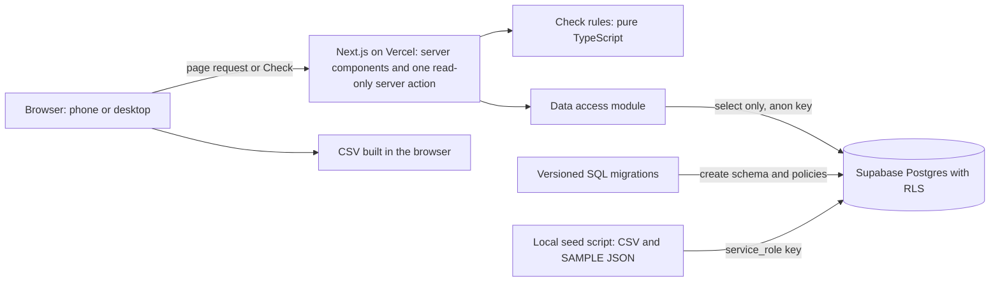
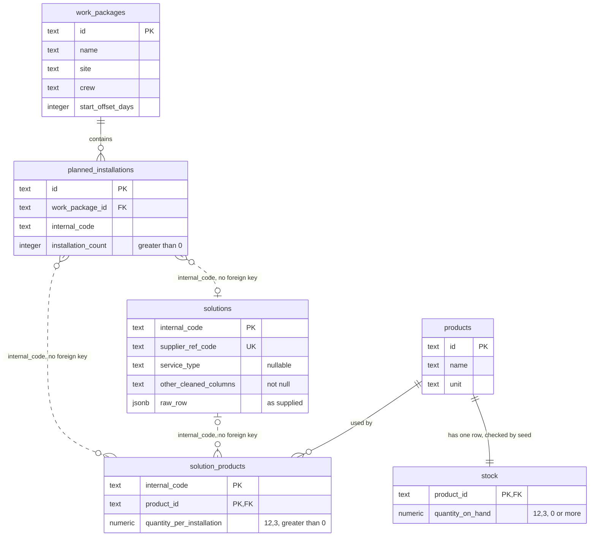

# Technical design: material readiness dashboard

This design implements [the first-slice specification](02-slice-spec.md). FR and AC numbers refer to that document. The [architecture decision records](adr/README.md) explain why it took this shape.

## Table of contents

1. [Overview](#1-overview)
2. [Terms](#2-terms)
3. [Projected coverage is not reservation](#3-projected-coverage-is-not-reservation)
4. [User flow](#4-user-flow)
5. [Components and interfaces](#5-components-and-interfaces)
6. [Data model](#6-data-model)
7. [Database as Code](#7-database-as-code)
8. [Where the business rules live](#8-where-the-business-rules-live)
9. [Sample data and the production inventory source](#9-sample-data-and-the-production-inventory-source)
10. [Fit with the stack and repository](#10-fit-with-the-stack-and-repository)
11. [Security](#11-security)
12. [Failure handling](#12-failure-handling)
13. [Deployment and CI/CD](#13-deployment-and-cicd)
14. [Main trade-offs](#14-main-trade-offs)
15. [Decisions](#15-decisions)

## 1. Overview

The slice is a Next.js web app that reads from Supabase Postgres and is deployed on Vercel. The app never writes to the database. The server loads the package list and runs the check on request, and the browser builds the CSV from the result it already holds.



## 2. Terms

| Term | Meaning |
| --- | --- |
| Solution | One row of the supplied catalogue, identified by `Internal Code`. |
| Work package | A planned piece of site work for a crew. Also called a package. |
| Planned installation | A use of one solution in a package, with the number of installations planned. |
| Product | A material used to install a solution. Products are SAMPLE data, because the catalogue has none. |
| On hand | The stock quantity currently recorded for a product. It may differ from what is physically there. |
| Check | The calculation run when the team leader clicks "Check", for the ticked packages. |
| Combined result | Each product's total required quantity across the checked packages, compared once with on hand. |
| Missing catalogue match | A planned installation whose code isn't in `solutions`. Its details stay blank, and its mapped products still count. |
| CSV snapshot | The file exported from the dialog. It isn't an audit record. |
| Current date | Today's date in Auckland (`Pacific/Auckland`), whatever time zone the server runs in. |

## 3. Projected coverage is not reservation

The combined result is a **projection**: a read-only comparison that answers "would recorded stock cover these selected packages together, if nothing else used it?"

| | Projected coverage (this slice) | Stock reservation (iteration 3 at the earliest) |
| --- | --- | --- |
| What it is | A calculation made each time "Check" is clicked | A stored commitment of stock to a package |
| Effect on inventory | None; the app has no write access | Would reduce the stock free for other work |
| Packages considered | Only the ticked ones | All committed packages |
| What a team leader can rely on | "The recorded figures appear sufficient for these packages together" | "This stock is held for this package" |

- **Enforcement:** RLS gives the app select-only access, and the calculation is pure, so it can't write anything.
- **Wording:** the dialog and CSV say stock isn't reserved (FR-5, FR-6). Calculated figures are never described as "allocated", "held" or "reserved".
- **Package priority:** none is needed, because the total is compared once and no stock is shared out between packages.
- **Stock freshness:** no threshold is used. The SAMPLE data has no source timestamp to display, so `exported_at` is only the export time.

## 4. User flow

1. **Open the dashboard (`/`).** All planned work packages appear soonest first, each with a tick box, name, site, start date and crew. The dashboard never shows a status, and a SAMPLE data notice is always visible.
2. **Tick packages and click "Check".** "Check" is disabled until a package is ticked. Clicking it reads current stock.
3. **Read the dialog.** The combined result comes first, then the notices, and the detail for each package. Reading a shortage answers the slice's decision: can this crew go ahead, or do stakeholders need telling?
4. **Click "Export".** The browser saves the CSV with no further server request.
5. **Act outside the system.** The team leader shares the file and reschedules crews if needed. Closing the dialog returns to the dashboard with the ticks kept. A later check reads stock again.

## 5. Components and interfaces

The repository has no application code yet, so this structure is new.

```text
src/app/page.tsx         dashboard (server component), plus error and empty states
src/app/actions/         runCheck server action
src/components/          package selector and results dialog (client), notices
src/domain/              quantity arithmetic, check rules, CSV builder, dates; no framework or database imports
src/data/                Supabase queries, mapping rows to domain types (server only)
scripts/seed.ts          validates seed files and writes to Supabase
data/source/             supplied CSV
data/sample/             SAMPLE data JSON file
supabase/migrations/     versioned schema and RLS policies
.github/workflows/       CI/CD pipeline
```

| Interface | Input | Output |
| --- | --- | --- |
| `GET /` | None | All packages with start dates, or the empty or error state |
| `runCheck` server action | Ticked package IDs | `ok` with the check result, `invalid_selection`, or `unavailable` |
| `listPackages(today)` in `src/data` | Current date | Packages ordered by `start_offset_days`, then `id` |
| `getCheckInputs(packageIds)` in `src/data` | Package IDs | Installations, matching solutions, solution products and stock |
| `checkPackages(input)` in `src/domain` | Those inputs | Combined rows and per-package detail, with quantities as decimal strings |
| `buildCsv(result, exportedAt)` in `src/domain` | Check result and export time | CSV text, built in the browser (FR-5) |

The check result crosses to the browser with quantities as decimal strings, because `BigInt` can't be sent as JSON. The dialog and CSV display those strings without further arithmetic. A later "Export" uses that same result, so the file matches the dialog even if the connection is lost (AC-24).

## 6. Data model

Spec section 2 lists each table's columns and constraints. Solid lines are foreign keys. Dotted lines match on `internal_code` with no foreign key.



### How demand reaches stock

This example is the AC-06 case, using two real catalogue codes with invented materials:

| Step | Table | Example |
| --- | --- | --- |
| 1. Find the ticked packages' installations | `planned_installations` | 10 of `0334`; 5 of `0335` |
| 2. Get each solution's details, leaving them blank if there's no match | `solutions`, by a left join on `internal_code` | Orientation, substrate and so on, cleaned |
| 3. Find the products each installation needs, joining directly rather than through `solutions` | `solution_products`, by `internal_code` | `0334` needs 2 Sample Sealant A; `0335` needs 1 |
| 4. Total by product | Calculated in `src/domain` | (10 × 2) + (5 × 1) = 25 |
| 5. Compare with stock | `stock` | 20 on hand, so `Short` by 5 |

### Key design points

- **Direct link to products:** `planned_installations` joins `solution_products` on `internal_code`, so finding products doesn't depend on a row in `solutions`.
- **No foreign key to `solutions`:** a supplier may be removed from the business, and that mustn't affect existing `planned_installations` or `solution_products` rows. Their codes stay, their catalogue details become blank, and their mapped products still count towards demand.
- **Consistency handled in code:** the seed script aborts if a planned installation has no mapped products, because `internal_code` isn't unique in `solution_products` and a foreign key can't point to it. It also enforces "every product has a stock row". It reports likely mistyped codes in `solution_products` but still writes them, because they look the same as codes from a removed supplier (spec section 2).
- **`raw_row`:** JSONB holding the supplied values, kept for traceability and never queried.
- **Sample IDs:** text IDs are for SAMPLE data only; production should use `bigint` or `uuid`.
- **SAMPLE labelling:** table names carry no prefix, so the labels are in the seed file, the UI notice and the CSV `notice` column.

## 7. Database as Code

- **Single source:** tables, constraints and RLS policies change only through timestamped SQL files in `supabase/migrations`, applied with the Supabase CLI.
- **Forward fixes only:** applied files are never edited. Each migration must stay compatible with the running app.
- **CI checks:** CI rebuilds a throwaway database from every migration. Before deploying, it applies new migrations and then fails if the production schema differs from them. The check comes second because any migration not yet applied would otherwise look like drift.
- **Applying migrations:** the owner applies them to the local project with the Supabase CLI. CI applies them to the production project.
- **Data kept separate:** migrations hold structure only. Data comes from `scripts/seed.ts`.

## 8. Where the business rules live

| Rule | Location |
| --- | --- |
| Quantity arithmetic, combined totals, `Short` and `Available` (FR-3) | `src/domain`, the single implementation |
| CSV columns, notice text, quoting and formula safety (FR-5) | `src/domain` |
| Package order (FR-1) | `src/data` |
| Completeness and valid values | Database constraints, and the seed script's checks before writing |
| On-screen notices (FR-6) | One module in `src/components`, so required wording is tested in one place |

**Exact decimals.** `src/domain` follows the method in spec section 2:
- `src/data` selects quantities with a text cast (`quantity_on_hand::text`), so they never become JavaScript numbers.
- The SAMPLE JSON also stores quantities as strings, such as `"0.1"`, for the same reason.
- Each string is held as a `BigInt` count of thousandths. The `numeric(12,3)` column and the seed's checks already limit it to nine whole digits and three decimal places, so the calculation doesn't check this again.
- This needs no new dependency, since `BigInt` is built into current browsers and Node.js.

**Check rules, in order:**
1. Each installation adds (count × quantity per installation) for each of its mapped products, whether or not its code is in the catalogue. Totals are kept per product and per package.
2. Each product's combined total is compared once with on hand. `Short` shows required minus on hand. `Available` shows no shortfall: the dialog and the CSV leave it blank.
3. Missing data is never treated as zero. A product with no stock row, or a planned installation with no products, can't come from the seed, so if found it fails the check as `unavailable` and is logged.

**CSV safety.** Values are quoted as standard CSV. Any text starting with `=`, `+`, `-` or `@` gets a leading apostrophe so it can't run as a spreadsheet formula.

## 9. Sample data and the production inventory source

The supplied CSV is a solutions catalogue with no products, material quantities, inventory, packages or schedules. Everything else is SAMPLE data.

- **Seed sources:** `data/sample/` holds one JSON file with a "SAMPLE DATA: invented for this exercise" field. Product names are fictional, so no mapping can be mistaken for a real specification.
- **Seed script:** it runs from the owner's machine against the local or production Supabase project, named explicitly each time. Each project's `service_role` key sits in its own git-ignored file, `.env.seed.local.local` or `.env.seed.production.local`, which Next.js doesn't load. It parses the CSV with a real parser, because `Substrate` contains quoted commas.
- **Writing:** all input is validated first, so invalid input writes nothing. It then upserts by primary key and deletes rows that are no longer in the files, so reruns give the same data.
- **Runtime:** deployed code reads only from Supabase. It never bundles or opens these files.

| The sample data lets us demonstrate | It leaves untested |
| --- | --- |
| `Short` and `Available`, combined totals, decimals, a missing catalogue match and the export | Whether real stock records are accurate or timely, whether real solutions have per-installation quantities, and real volumes |

**What production would need from an inventory source.** The brief doesn't identify a stock system, so these are requirements rather than a chosen product:
- **Stock figures:** the quantity on hand for each product, with its unit and location. "No record" must be distinguishable from zero.
- **Matching products:** stock items must use the same product IDs as each solution's list of materials. The team that owns specifications must confirm those materials and quantities, or shortage figures will be wrong.
- **Responsibility and access:** a named person or team keeps stock figures correct, and one customer must never see another customer's stock.
- **Timing:** a timestamp showing when each figure was last updated, so the screen can display it. A freshness limit applies only if the business agrees one.

## 10. Fit with the stack and repository

| Technology | Use in this slice | Reason |
| --- | --- | --- |
| Next.js, React, Node.js | UI, server rendering and one server action | Current stack; keeps queries on the server |
| Supabase | Postgres database and migrations | Current stack; constraints and RLS provide the needed guarantees. Auth, realtime and storage aren't needed |
| Vercel | Hosting | Current stack; provides the public URL |
| Flutter | Not used in this slice | The check happens before site work, with a connection (assumption 2). A responsive web page covers phone use |

There are no departures from the stack. New dependencies are limited to `@supabase/supabase-js`, TypeScript, ESLint, the Supabase CLI, a CSV parser for the seed script, and the test tools set out in the test strategy. There is no UI component library, since CSS Modules and the native `<dialog>` element are enough.

### Two ways this could fit the existing platform

The existing web app's code isn't part of this exercise, so both options need validating against it.

| | New service on the same stack | Feature in the existing web app |
| --- | --- | --- |
| **Benefits** | Independent releases; the team already knows the stack | Reuses sign-in, tenants and real records; one place for users |
| **Costs** | Needs shared sign-in, plus access to project and stock data | Tied to that app's conventions and release cycle |
| **What moves** | `src/domain` and the screens stay; `src/data` reads real sources | `src/domain` and the screens move in; `src/data` is rewritten |
| **Use it when** | A separate team or release cycle justifies the extra integration | By default, because this slice is mostly screens over existing data |

This repository takes the new-service shape, because the existing code isn't available and the brief needs a public URL. For production, the recommendation is the feature in the existing web app.

### Offline-first mobile app

Neither option changes the Flutter app now. If team leaders prove to need this check on site, the rules would be exposed through an API, and the mobile screen would need to show when its data was last synced.

## 11. Security

- **Least privilege:** the running app uses only the anon key, held in a server-side environment variable with no `NEXT_PUBLIC_` prefix. Every table has RLS enabled with a select-only policy and no write policies, defined in migrations and covered by tests.
- **`service_role` key:** used only by the local seed script. It is never stored in Vercel, GitHub or browser code. CI's throwaway database has its own disposable keys.
- **Browser access:** browser code never contacts Supabase.
- **Input:** `runCheck` validates that it received a non-empty list of IDs and that every ID exists. It reads everything else from the database, and never accepts quantities from the client.
- **Output:** React escapes output, and CSV values are protected against formulas (section 8).
- **Public demo:** with no sign-in, anyone can read the SAMPLE data, which holds nothing private. Because nothing can be written, there is nothing for one visitor to change for another.
- **Production gaps:** real sign-in, roles, tenant-scoped RLS and rate limiting.

## 12. Failure handling

| Failure | Behaviour |
| --- | --- |
| Database unavailable when the dashboard loads | Error and retry, no list (AC-25). Logged on the server |
| Database unavailable on "Check" | `unavailable`: error and retry, no result and no "Export" button (AC-27). Ticks are kept |
| No planned work packages | "No planned work packages" (AC-26) |
| Ticked package no longer exists after a reseed | `invalid_selection`: asks the user to reload the dashboard |
| Stored data breaks an assumption (section 8) | `unavailable`, logged as a data problem, never shown as zero stock |
| Connection lost after a check | Export still works, because no request is needed (AC-24) |
| Seed input invalid | The script stops with a clear error before writing |
| Seed connection lost part-way | Data may be partly updated until the script is rerun, because the writes aren't one transaction. Only the owner runs it |
| Migration fails | The pipeline stops before deploying, and the running version stays live |

Pages are rendered dynamically without caching, so a failed request is never served as stale success.

## 13. Deployment and CI/CD

| Database | Used by | Seeded by |
| --- | --- | --- |
| Local Supabase project (online) | Local development | The seed script, run from the owner's machine |
| Production Supabase project | The deployed app | The seed script, run from the owner's machine |
| Throwaway Supabase in CI | Integration and end-to-end tests | The seed script, with disposable keys |

| Trigger | Steps |
| --- | --- |
| Every push | `npm ci`, lint, type-check, unit tests, rebuild a throwaway Supabase from migrations, build, check browser files, seed, and run integration and end-to-end tests |
| Push to `main`, after those pass | Apply new migrations to production, check it for drift, deploy with the Vercel CLI, then check the public URL responds. The fuller smoke test is switched off for now |

- **Gate:** Vercel's automatic Git deployments are turned off, so nothing reaches production without passing CI.
- **Seeding is manual:** if a change needs new data, the owner runs the seed script against each project. CI never holds either project's `service_role` key.
- **Secrets:** the Supabase access token, production database password and Vercel token are GitHub Actions secrets. Runtime values are Vercel environment variables, pointing at the production project.
- **Evidence:** the Actions run history shows each deployment. With the smoke test off, a green deploy proves the site responds, not that its data is right.
- **Control:** actions are pinned to commit SHAs and the runner to one image version. Each job has a time limit, and runs on `main` wait their turn, so deploys never overlap.
- **Diagnosis:** if the live check or smoke test fails, the pipeline prints the site's server errors from Vercel's runtime logs, because the error page hides them.
- **Environments:** one deployed environment is enough for the exercise. Real production use would add staging and a rollback procedure.

## 14. Main trade-offs

| Decision | Benefit | Cost or risk | Alternative rejected |
| --- | --- | --- | --- |
| Combined check across ticked packages | Matches how team leaders work across several packages | Doesn't show which package would go without, and ignores unticked packages (disclosed) | Per-package check: little business value |
| Load all packages, no pagination | Simple list and selection | Relies on assumption 1; Supabase's default limit of 1,000 rows per response would need handling at volume | Pagination: unneeded complexity at this size |
| Rules in TypeScript rather than SQL | Fast unit tests, and easy to explain and reuse | Rows must be fetched first, and the database doesn't check the results | SQL view or function: harder to test and tied to the database |
| `numeric` with `BigInt` arithmetic | Exact results with no new dependency | Quantities must be cast to text at every read, and the three-decimal limit is fixed | JavaScript numbers: floating point errors; decimal library: an unneeded dependency |
| Server action for the check | Little client code, and queries stay on the server | No API ready for the mobile app | REST route: no second consumer yet; browser queries: would move rules and data access to the client |
| CSV built in the browser | No server work or storage, and matches the dialog exactly | No record that an export happened (disclosed) | Server-side export: could differ from the dialog and adds an endpoint |
| No foreign key to `solutions` from `planned_installations` or `solution_products` | Removing a supplier doesn't affect existing rows, and a missing catalogue match can be stored with its mapped products still counted. Foreign key checks cost time on writes, so a future high-concurrency write path avoids them. This slice gains no speed from it, because the app doesn't write | The database won't catch a mistyped code. The seed script can only report a likely one, and a production write path would need its own checks | Foreign keys: removing a supplier would be blocked or would remove existing rows, and blank details could never occur |
| Anon key with select-only RLS | The database enforces read-only access whatever the app does | Policies need their own tests | Service-role key: bypasses RLS |
| Separate local and production Supabase projects | Local work can't change the data reviewers see | Migrations and seeding must be applied to both | One shared project: simpler, but local changes would reach the public demo |
| Seed run only from the owner's machine | The most powerful keys stay out of CI and Vercel | New data isn't deployed automatically | Seeding in CI: wider exposure of the keys |
| Public access with no sign-in | Reviewers can try the flow immediately | Not suitable for real data | Real auth: adds little to the slice's decision |

## 15. Decisions

These are the choices for the demo. Each should be discussed and redesigned for real projects.

| Topic | Choice for the demo | To resolve for real projects |
| --- | --- | --- |
| Current date | Auckland time, because the demo will be presented in Auckland. Daylight saving is handled, and viewers elsewhere still see Auckland dates | Which time zone applies to each site |
| Missing catalogue match | Blank details, with mapped products still counted | Whether planning records should be chosen from the catalogue, and how code keeps these links consistent |
| Packages shown | Every visitor sees all SAMPLE packages | Each team leader sees their own packages, through sign-in |
